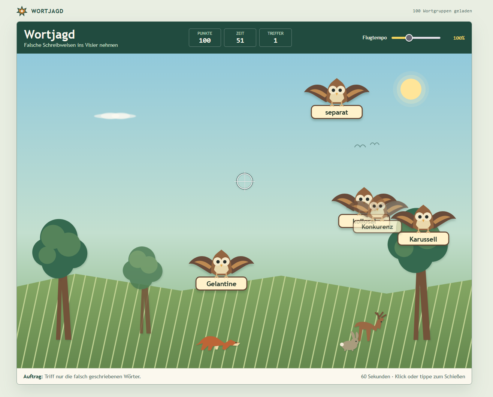

!!! Achtung VibeCode -- ich gebe keinerlei Garantie -- Work in Progress !!!

# Wortjagd

`index.html` direkt im Browser öffnen. Zum Start `wortliste.txt` auswählen.
Der Browser liest die ausgewählte Datei lokal; ein Webserver oder eine
Internetverbindung wird nicht benötigt.



## Wortliste bearbeiten

Jede nicht leere Zeile enthält ein korrektes Wort zuerst, danach mindestens
eine falsche Schreibweise. Die Einträge werden mit Kommas getrennt:

```text
Fahrrad, Farrad, Fahrad
nämlich, nähmlich, nehmlich
```

Pro Runde laufen 60 Sekunden. Falsch geschriebene Wörter bringen 100 Punkte;
ein Treffer auf die richtige Schreibweise zieht 150 Punkte ab. Alle Wörter
erscheinen zufällig. Leere oder fehlerhaft formatierte Zeilen werden beim Laden
übersprungen.

Die 100 Wortgruppen sind eine Auswahl aus den von Duden aufgeführten häufigen
Falschschreibweisen. Die Duden-Liste ist alphabetisch, nicht nach Fehlerhäufigkeit
sortiert; eine statistische Rangfolge der 100 häufigsten Fehler wird daher nicht
behauptet. Siehe [Duden: Häufige Fehler und Falschschreibweisen](https://www.duden.de/haeufige_fehler).
